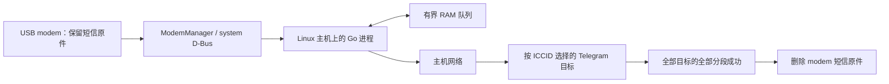

# 架构与投递语义

DJI SIM Box 独立运行在 Linux 主机上。USB modem 与 ModemManager 负责蜂窝接收和协议处理，Go 进程通过系统 D-Bus 读取事件，经主机网络向 Telegram 投递；运行时无需共享文件系统或远端数据库。



## 组件与事实归属

| 组件 | 职责 |
| --- | --- |
| `internal/modem` | 发现 modem/SIM，接收完整短信和被动来电事件，确认短信原件释放；ModemManager 负责协议与多段短信组装。 |
| `internal/config` | 严格 JSON、私有凭据和 ICCID 到收件人的显式映射。 |
| `internal/queue` | 来源身份、首次分配的收件人、有序分段、容量、重试和完成状态，全部保存在内存。 |
| `internal/telegram` | 纯文本格式、Unicode 安全分段、有界 HTTPS 请求和脱敏错误分类。 |
| `internal/app` | 协调接收与独立投递循环，网络等待不阻塞接收。 |
| `cmd/djisimbox` | 生命周期、tmpfs 检查、单实例锁及私有状态 socket。 |

直接 Go 依赖为 `github.com/godbus/dbus/v5`，传递依赖见 `go.mod`/`go.sum`；程序没有短信数据库。

## 短信生命周期

1. 先订阅事件，再读取启动快照；modem 事件、投递完成会触发重新核对，另有每分钟兜底检查。
2. 读取接收 SIM 的 ICCID。未知身份或没有路由的通知不选收件人，短信原件保留。
3. 只接纳完整的入站 SMS-DELIVER 文本。未完成多段、外发、状态报告与二进制对象留在 modem。
4. 首次接纳时固定收件人和文本分段。目标之间独立推进，同一条通知在各目标内按分段顺序发送。
5. 网络错误、超时和限流退避重试；Telegram 永久失败保留原件并等待修复。筛选受节流的目标后再限制每批数量，让其他 bot 继续投递。
6. 全部目标的全部分段成功后，请求删除 modem 原件。删除成功，或之后同一 modem、SIM 与 D-Bus owner 的有效快照证实原件已消失，才释放队列。删除响应丢失时，先在 RAM 中保留待确认状态。

来源键包含主机启动身份、ModemManager 的唯一 D-Bus owner、modem/消息对象路径及 SIM。它只区分对象生命周期，不按号码、时间或正文做全局去重。未知时间保持缺失。

每个 modem 存有短信期间需固定 SIM：短信接口没有历史接收 ICCID。换卡前排空原件，避免把旧短信归给新卡。多个同时在线 modem 可各自固定 SIM，仍需完成硬件验收。

重启清空内存投递记录；未删除原件会重新读取，可能再次发给已成功的目标。丢失 Telegram 响应、ModemManager 更换 owner 也可能导致重复。该行为依赖 modem 保留原件，无法保证只投递一次或无限等待断网。modem 消失、SIM 身份变化或 ModemManager owner 变化会让进程退出，由 systemd 重启并重建队列。

## 来电通知

通过 [Voice](https://www.freedesktop.org/software/ModemManager/doc/latest/ModemManager/gdbus-org.freedesktop.ModemManager1.Modem.Voice.html) 的 `Calls` 和 [Call](https://www.freedesktop.org/software/ModemManager/doc/latest/ModemManager/gdbus-org.freedesktop.ModemManager1.Call.html) 只读属性，明确观察到入站响铃或呼叫等待时生成通知。通知复用 SIM 路由、内存预算与重试；号码缺失时显示未知，时间取首次本地观察，后续属性变化不改写该条通知。

成功确认仅改变 RAM。程序不调用 `Accept`、`Hangup`、`DeleteCall` 等呼叫控制；已确认的活动呼叫保留去重状态，终止或确认消失后释放。已入队通知可在响铃结束后继续投递，短信与来电读取失败各自处理。

来电没有可恢复原件。停机、未观察到的短呼叫、满队列拒绝后呼叫结束或进程重启都可能丢失通知；响铃中重启可能重复。音频与已结束呼叫历史不在实现范围。

## 内存、日志与主机保护

默认最多 10000 条活动通知及 16 MiB 逻辑内容预算。预算包含原文、元数据、渲染分段和固定开销，不是 Go 堆内存上限。队列满时短信留在 modem；实际可用容量还受 modem 存储限制。

运行锁和 socket 位于 tmpfs `/run/djisimbox`；程序拒绝其他文件系统，不创建队列快照或重试文件。状态 socket 为 `0600`，只提供数量与预算。静态配置、凭据和 binary 是安装文件。

systemd 单元使用专用账户、只读系统目录、无 capabilities、禁用服务 swap 和 core dump。日志命名空间使用容量受限的 volatile journal，关闭转发，配套 drop-in 清除持久 `LogsDirectory`。这些约束覆盖本服务及其日志；主机系统与 modem 固件仍有各自的存储行为。

部署阶段先保护蜂窝主机网口。networkd 按 USB `2c7c:0125` 保持接口关闭并阻止地址配置；应用同时检查该身份和 ModemManager 报告的网口。程序不会创建或连接数据 bearer，必要的 modem 启用用于接收注册。Polkit 授予专用账户 `Messaging` 和 `Device.Control` 权限，粒度大于程序实际使用的接收、原件删除与模块启用操作。

主机保护无法限制固件内部 IMS 流量，不能作为免漫游费用保证。[ModemManager 的 LTE 连接说明](https://modemmanager.org/docs/modemmanager/ip-connectivity-setup-in-lte-modems/)区分模块注册、初始 bearer 与主机数据路径。

## 源码构建与验证

使用 Go 1.26+；运行与硬件接口面向 Linux。测试所用 `dbus-daemon` 应在执行环境可用，D-Bus 合约测试启动隔离 daemon，不连接真实硬件。

在源码根目录执行：

```sh
go test -race -count=1 ./...
go vet ./...
go mod verify
CGO_ENABLED=0 GOOS=linux GOARCH=arm64 go build -trimpath -o bin/djisimbox-linux-arm64 ./cmd/djisimbox
```

交叉编译可在开发机完成，目标主机仅需运行依赖。安装时以 `bin/djisimbox-linux-arm64` 作为 binary 来源，部署文件沿用[安装指南](../docs/install.zh-CN.md)。版本注入、发布包 allowlist 与 CI 见[发布流程](releasing.md)。

维护的自动化测试覆盖路由隔离、容量、Unicode、重试、公平调度、完成与原件释放、错误脱敏、私有状态、真实隔离 D-Bus 信号及 daemon 更换。硬件兼容范围见[用户文档](../README.zh-CN.md)。协议依据另见 [Messaging/SMS API](https://www.freedesktop.org/software/ModemManager/doc/latest/ModemManager/gdbus-org.freedesktop.ModemManager1.Modem.Messaging.html)、[Telegram sendMessage](https://core.telegram.org/bots/api#sendmessage) 和 [volatile journal](https://www.freedesktop.org/software/systemd/man/latest/journald.conf.html)。
